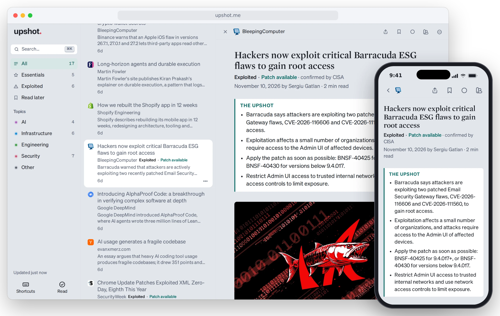

<!--markdownlint-disable-->

[](https://github.com/davelevine/upshot/actions/workflows/build.yml)
[](https://upshot.me)
[](https://upshot.me/rss.xml)

<div align="center">

<h1>
  <picture>
    <source media="(prefers-color-scheme: dark)" srcset=".github/wordmark-dark.svg">
    
  </picture>
</h1>

The week’s tech news, minus the noise.

<br>

<picture>
  <source media="(prefers-color-scheme: dark)" srcset=".github/screenshot-dark.webp">
  
</picture>

</div>

<div align="center">

| Pipeline | Site | AI | Automation |
|---|---|---|---|
| [](https://www.python.org/) [](https://github.com/kurtmckee/feedparser) | [](https://workers.cloudflare.com/) [](https://developer.mozilla.org/en-US/docs/Web/JavaScript) [](https://github.com/mozilla/readability) | [](https://www.anthropic.com/claude) | [](https://github.com/features/actions) |

</div>

Upshot is a news digest for AI, security, infrastructure, software engineering and tech regulation. I wanted to keep up with all of it without reading every feed myself, so I built something that does the first pass for me. It reads a curated list of feeds, keeps only the stories worth reading, sums each one up in a sentence, and picks five weekly essentials with what to do about each. It's inspired by [watch.edebost.com](https://watch.edebost.com/).

## Features

- **Only what matters.** A handful of stories on a big day, none on a slow one, each with a one-line summary.
- **Exploited flaws flagged.** Flaws under active attack are tagged **Exploited**, with whether a patch is out; supply-chain attacks are tagged **Compromised**.
- **Weekly essentials.** Five picks from the last seven days, each with what to do about it.
- **Built-in reader.** Articles open in a clean pane that starts with the upshot: what happened, who's affected and what to do. Set them in a serif or a sans, from six typefaces.
- **Read state, Read later and sync.** Read stories are dimmed (or hidden, if you'd rather), the reader's bookmark sets a story aside in Read later, and sync keeps both, and the theme and typeface, the same across your devices with a code. No account.
- **Phone and desktop.** Install it as an app on a phone; `⌘K` search, `j`/`k` and `Space` to move through stories, and a full-screen reader on a desktop. Light, dark or the system's theme, and an RSS feed.

## How it works

Every hour, a GitHub Actions job runs [`build.py`](build.py), which fetches the feeds in [`feeds.opml`](feeds.opml) and has Claude Haiku score and summarize each new story. The stories that clear the bar are committed to the repository as a small JSON file, and each article's text is stored in Cloudflare KV. A Cloudflare Worker serves the static front end and that stored text, so the reader never fetches from publishers. There's no server or database to look after; the [architecture overview](docs/architecture/overview.md) has a diagram and the details.

## Running your own copy

You'll need a GitHub account, a Cloudflare account and a Claude Pro or Max subscription. Everything else runs on the free tiers of GitHub Actions and Cloudflare Workers, and setup takes about fifteen minutes. [Getting started](docs/setup/getting-started.md) walks through it.

## Developing

```bash
python3 -m venv .venv && .venv/bin/pip install -r requirements.txt pytest
.venv/bin/pytest -q
npm ci && node --test 'tests/*.test.js'
npx wrangler dev -c wrangler.jsonc -c sync/wrangler.jsonc --infer-origin-from-routes=false --port 8788
```

More in [development](docs/development.md).

## Built With Claude

This project was built using AI-assisted development with [Claude](https://claude.ai). I told it what to build and then said "no, not like that" a lot. The AI did a lot of typing. Commits with substantial AI contributions are marked with `Co-authored-by` tags because we're not going to pretend otherwise.

## Credits

- [watch.edebost.com](https://watch.edebost.com/) — the inspiration, design language and palette
- [Mozilla Readability](https://github.com/mozilla/readability) and [linkedom](https://github.com/WebReflection/linkedom) — article extraction
- [feedparser](https://github.com/kurtmckee/feedparser) — making sense of every feed format there is
- [Feedbin](https://github.com/feedbin/feedbin) — the reader's display options icon (MIT License, © 2013 Ben Ubois) and the layout of its typefaces
- [Literata](https://github.com/googlefonts/literata) (TypeTogether) and [Atkinson Hyperlegible Next](https://github.com/googlefonts/atkinson-hyperlegible-next) (Braille Institute) — two of the article typefaces (SIL Open Font License 1.1)
