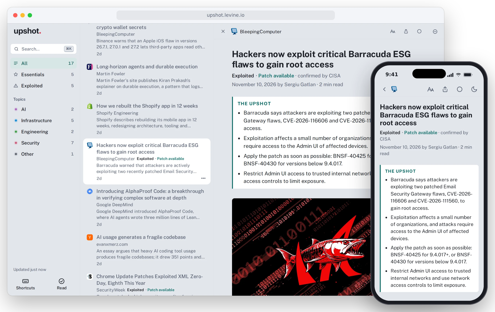

<!--markdownlint-disable-->

[](https://github.com/davelevine/upshot/actions/workflows/build.yml)
[](https://upshot.levine.io)
[](https://upshot.levine.io/rss.xml)

<div align="center">

<h1>
  <picture>
    <source media="(prefers-color-scheme: dark)" srcset=".github/wordmark-dark.svg">
    
  </picture>
</h1>

The week’s tech news, minus the noise.

<br>

<picture>
  <source media="(prefers-color-scheme: dark)" srcset=".github/screenshot-dark.webp">
  
</picture>

</div>

<div align="center">

| Pipeline | Site | AI | Automation |
|---|---|---|---|
| [](https://www.python.org/) [](https://github.com/kurtmckee/feedparser) | [](https://workers.cloudflare.com/) [](https://developer.mozilla.org/en-US/docs/Web/JavaScript) [](https://github.com/mozilla/readability) | [](https://www.anthropic.com/claude) | [](https://github.com/features/actions) |

</div>

Upshot is a news digest for AI, security, infrastructure, software engineering and tech regulation. It reads a curated list of feeds, has an LLM keep only the stories worth your time, writes each one up in a sentence, and picks five weekly essentials with what to do about each. It's inspired by [watch.edebost.com](https://watch.edebost.com/).

There's no server or database to look after. A scheduled GitHub Actions job commits a small JSON file; a static page renders it. It runs on the free tiers of GitHub Actions and Cloudflare Workers, plus a Claude subscription.

## What you get

- **A calm feed.** A handful of stories on a big day and none on a slow one. Each shows its source's icon, a one-line summary and how long ago it was published, with topics in a sidebar and search.
- **The week's essentials.** Five picks from the last seven days, each with what to do about it, under their own entry beside the topics and marked where they appear in the feed.
- **A built-in reader.** Articles open in a clean pane that starts with the upshot: a few bullets on what happened, who's affected and what to do. On wide screens the pane sits beside the list, as in a desktop feed reader.
- **It remembers where you were.** New stories are marked, read ones are dimmed, and none of that leaves your browser. As in Feedbin, **Read** marks a whole list read (after asking), and the selected story's `…` marks everything above or below it.
- **Works everywhere.** Swipe and install as an app on a phone; `⌘K` search and `j`/`k` navigation on a desktop (`?` lists the shortcuts). Light and dark themes, and an RSS feed.

## How it works

Every four hours, [`build.py`](build.py) fetches the feeds in [`feeds.opml`](feeds.opml) and sends each new story to Claude Haiku on its own, which gives it a category, a relevance score and a one-sentence summary. Stories that clear their category's bar and aren't repeats are published; once a day the model picks the week's five essentials. The build also extracts each article's text with Mozilla's Readability and stores it in Cloudflare KV, so the reader never fetches from publishers and nothing runs from the source page.

The front end is [`site/index.html`](site/index.html) and [`site/app.js`](site/app.js): no framework, no build step. A Cloudflare Worker serves it and answers the reader's requests.

For the full pipeline, the reader's security model, and how the build looks after itself, see **[docs/architecture.md](docs/architecture.md)**.

## Run your own copy

Setup takes about fifteen minutes. The only paid piece is a Claude subscription (Pro or Max); the build uses it through the Claude Code CLI, so there's no API key.

1. **Fork the repository** and enable workflows in the fork's **Actions** tab.
2. **Create the Claude token.** Run `claude setup-token` where you're signed in to Claude Code, and save the result as a repository secret named `CLAUDE_CODE_OAUTH_TOKEN`.
3. **Create a Cloudflare KV namespace** for article text. Put its ID in both `kv_namespaces` entries in [`wrangler.jsonc`](wrangler.jsonc), and add `CF_API_TOKEN`, `CF_ACCOUNT_ID` and `CF_KV_NAMESPACE_ID` as secrets.
4. **Connect Cloudflare Workers** to the fork (**Workers & Pages → Create → Import a repository**), naming the Worker `upshot`. Set `routes` in `wrangler.jsonc` to your domain, or use `workers_dev`.
5. **Add a `SITE_URL` variable** with your site's address.
6. **Make it yours:** links and `og:url` in `site/index.html`, the badges above, and your feeds.
7. **Run the first build** from **Actions → Build → Run workflow**, with `backfill_days` set to `30` to fill in the last month.

Each step in detail, plus adding feeds, the configuration knobs, and keeping the schedule on time: **[docs/setup.md](docs/setup.md)**.

## Developing

```bash
python3 -m venv .venv && .venv/bin/pip install -r requirements.txt pytest
.venv/bin/pytest -q
npm ci && node --test 'tests/*.test.js'
npx wrangler dev --port 8788
```

Local runs, the browser smoke test, test fixtures and CI are in **[docs/developing.md](docs/developing.md)**.

## Built With Claude

This project was built using AI-assisted development with [Claude](https://claude.ai). I told it what to build and then said "no, not like that" a lot. The AI did a lot of typing. Commits with substantial AI contributions are marked with `Co-authored-by` tags because we're not going to pretend otherwise.

## Credits

- [watch.edebost.com](https://watch.edebost.com/) — the inspiration, design language and palette
- [Mozilla Readability](https://github.com/mozilla/readability) and [linkedom](https://github.com/WebReflection/linkedom) — article extraction
- [feedparser](https://github.com/kurtmckee/feedparser) — making sense of every feed format there is
