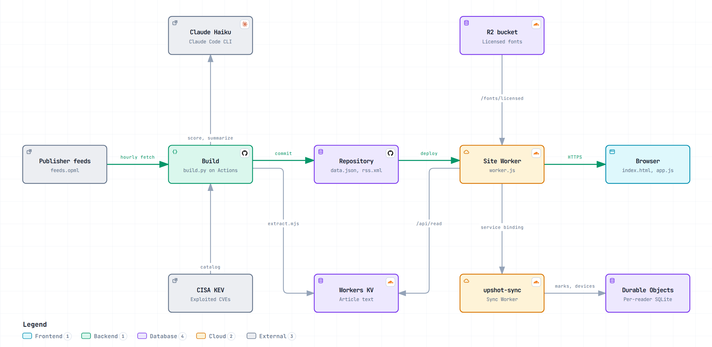

# Architecture

These pages cover how a story gets from a publisher's feed to the page, and what the reader does with it once it's there.

## How it fits together

<picture>
  <source media="(prefers-color-scheme: dark)" srcset="diagram/architecture-dark.png">
  
</picture>

<!-- Source: diagram/upshot.architecture.json. Regenerate with Archify: archify deliver architecture upshot.architecture.json upshot-architecture.html --quality showcase -->

The diagram leaves out one link: the Site Worker's cron starts the build every hour, with GitHub's own schedule as the fallback.

There's no server or database to look after. Upshot has three pieces:

1. **The build.** Every hour, a GitHub Actions job runs [`build.py`](../../build.py). It reads the feeds, has Claude Haiku score each new story, and keeps only the ones worth reading. It also extracts each article's text into Cloudflare KV for the reader. Then it commits a small JSON file and an RSS feed back to the repo.
2. **The Workers.** Cloudflare deploys the push. A Worker serves the static site, answers the reader's requests from KV, and starts the build on a cron trigger. A second Worker, `upshot-sync`, keeps what you've read the same across your devices, if you turn that on.
3. **The page.** Plain HTML and JavaScript, with no framework and no build step, that renders the JSON in a layout borrowed from desktop feed readers.

Everything else in these pages is detail on one of those three.

## The pages

- **[The pipeline](pipeline.md):** what the hourly build does, step by step, from fetching feeds to publishing.
- **[Exploited flags](exploited-flags.md):** how a story gets tagged **Exploited** or **Compromised**, and the checks behind those tags.
- **[The site](site.md):** the layout at each screen width, how lists and labels work, what counts as unread, and the pass that runs through the wordmark.
- **[The reader](reader.md):** how articles are extracted and stored, what the upshot bullets are, and what the reader does (and won't do) with your data.
- **[Typography](typography.md):** the licensed fonts, how they're tuned, and how they get to the page.
- **[Sync](sync.md):** keeping what you've read in step across devices with no account, and the designs I tried before this one.
- **[Hosting](hosting.md):** the Worker's configuration, how deploys happen, and how the build looks after itself.
